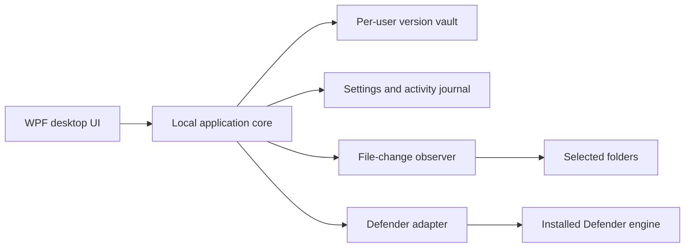
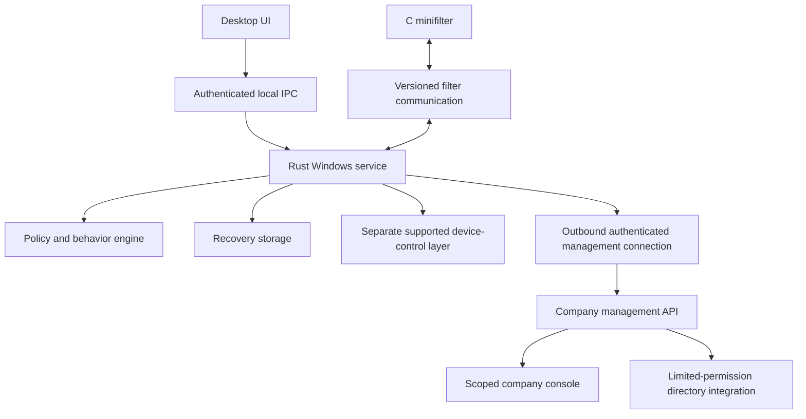

# Architecture and component design

## Initial architecture

The desktop owns the observer lifetime. The core owns validation, storage, and
operations. The scanner adapter creates only a supported Defender process with
structured arguments; it does not execute arbitrary shell commands. No service,
driver, remote server, or cloud connection is implied by this diagram.

## Component contracts

**Vault:** validate selected folder/file; stream a candidate to a temporary blob;
hash while copying; reject inconsistent/oversized input; atomically finalize blob
and metadata; verify hash before restore; create a destination copy exclusively.

**Observer:** register supported folders, enqueue notifications in a bounded
channel, debounce frequent changes, capture readable files, and log queue overflow
or watcher errors. Initial baseline is explicit. Deletion notifications cannot
recover bytes already lost; restoration uses versions captured earlier.

**Scanner:** validate target; discover installed MpCmdRun from expected Windows
locations; request custom scan without automatic remediation; capture bounded
stdout/stderr and exit information. A successful process exit is not automatically
a clean verdict. Completed/failed/unavailable states stay distinct.

**Inventory:** enumerate Windows-reported volumes without requesting destructive
operations. Drive letters are display locations, not permanent device identities.

**UI:** present operations and errors on the dispatcher; perform file work off
the UI thread; avoid fake scores and undeveloped action buttons. Closing the app
stops observation and must be communicated.

## Proposed future architecture

## Future trust boundaries

Unprivileged UI to service: authenticate caller identity, authorize action, validate
length/type/path, apply request limits, and use secured IPC endpoints. Never trust
the UI merely because it runs on the same host.

Service to kernel: secure connection ACL, authenticated service identity, explicit
wire version and sizes, bounded deadlines, and validated replies. No unbounded
waiting or large-file copying inside driver callbacks. Avoid reentrant operations
that recursively wait on the same service.

Endpoint to server: unique enrolled device identity, TLS, command authorization,
tenant scope, expiration, idempotency, and audit records. AD membership alone is
not an enrollment credential. Do not require domain-admin credentials in agents.

## Failure behavior

- Missing scanner: scanning unavailable; recovery remains usable.
- Denied/locked source: capture failure is visible; earlier versions retained.
- Vault full: decline new captures; do not silently purge the only recovery copy.
- Corrupt blob: refuse restore; never report successful recovery.
- Observer overflow: mark observation degraded and offer a new baseline.
- Disconnected future server: cached local policy continues; remote commands wait
  only until expiration and statuses show last contact.
- Disconnected future service: driver follows documented per-operation failure
  policy; neither indefinite waits nor blanket denial of boot-critical writes.

## Implementation boundaries

Initial C# core is a deliberate prototype choice supported by the installed .NET
toolchain. Rust/C service and driver are later milestones. Use interfaces and
serialized contracts so the UI can be retained when the privileged engine changes.
