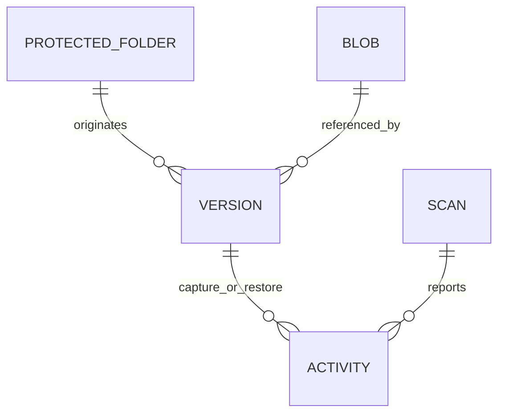

# Data and recovery design

## Storage model

Per-user root: `%LOCALAPPDATA%\KevlarEDR`. Separate metadata, content blobs, and
temporary writes. The root is private application data, not a protected hardware
partition. Windows user permissions provide only the ordinary per-user boundary.

Settings include schema version and selected folders. Version records include a
unique ID, canonical source path, original filename, capture UTC timestamp, byte
count, SHA-256 content digest, and capture reason. Event records include timestamp,
operation, outcome, and concise detail. Scan output is bounded and stays local.

Logical relationships:

Content-addressed blobs allow identical versions to share bytes. Hash equality
helps integrity/deduplication; it is not a malware verdict or proof of origin.
Dates are stored in UTC and displayed using the user's local timezone.

## Capture transaction

1. Validate source, folder ancestry, and absence of unsupported reparse points.
2. Acquire the vault operation lock with a bounded wait.
3. Record source size/modification information.
4. Copy to a randomly named temporary file while hashing and enforcing limits.
5. Recheck source information. Decline inconsistent capture rather than claim a
   coherent version; metadata checks cannot prove consistency against every writer.
6. Check vault capacity and version-record limits.
7. Finalize the content blob, then atomically replace metadata.
8. Record success only after metadata commit. On failure retain prior records.

Crash between steps 7 and 8 may leave an orphan blob. It consumes capacity but is
not presented as a valid version. Later maintenance can identify orphans after
verification; initial release does not silently delete user recovery data.

## Restore transaction

1. Load the selected version by ID from authoritative metadata.
2. Validate destination and reject vault/self/reparse-point targets.
3. Verify stored content length and SHA-256.
4. Stream a copy to a temporary file in the destination, verifying copied bytes.
5. Move to a new destination name without replacement; add a suffix on collision.
6. Record success and display the exact resulting path.

Never use the original source path as an implicit privileged restore target.
Never overwrite the current file merely because a previous version exists.

## Quotas and retention

Initial defaults: 32 MiB per source file, 512 MiB blob budget, bounded metadata and
activity records. These are prototype limits, not performance guarantees. Reject
oversize versions with a visible event. Recovery metadata is never evicted without
an explicit policy; activity history may retain only the most recent entries.

Future retention must model recovery windows, minimum-good versions, locked legal
holds, orphan cleanup, and an external backup copy. Backup encryption requires
key recovery, rotation, authenticated encryption, and restore tests before release.

## Migration

Every stored document has a schema version. Unsupported schemas fail clearly.
Future migrations back up metadata, validate all references, and commit atomically.
Do not deserialize arbitrary types or treat a modified manifest as authorization
to read/write unrestricted paths.
